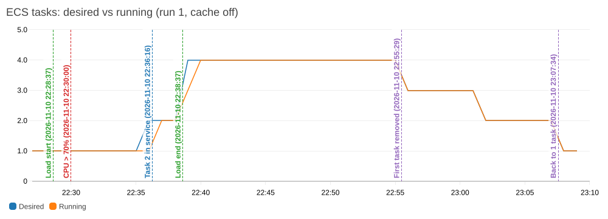
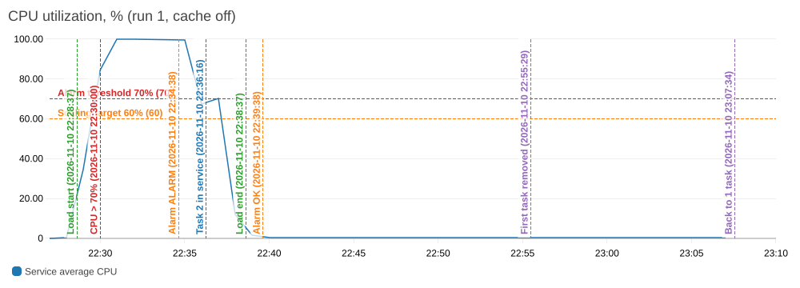
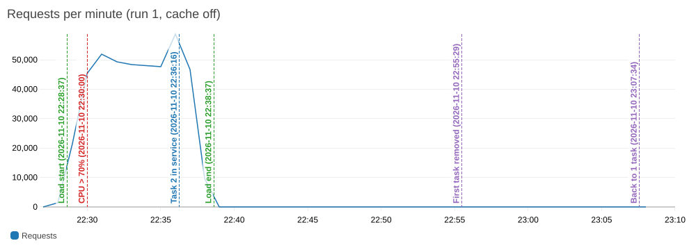
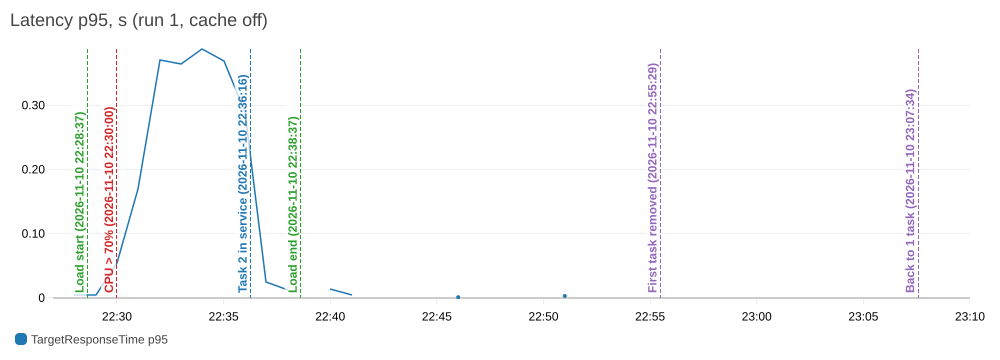
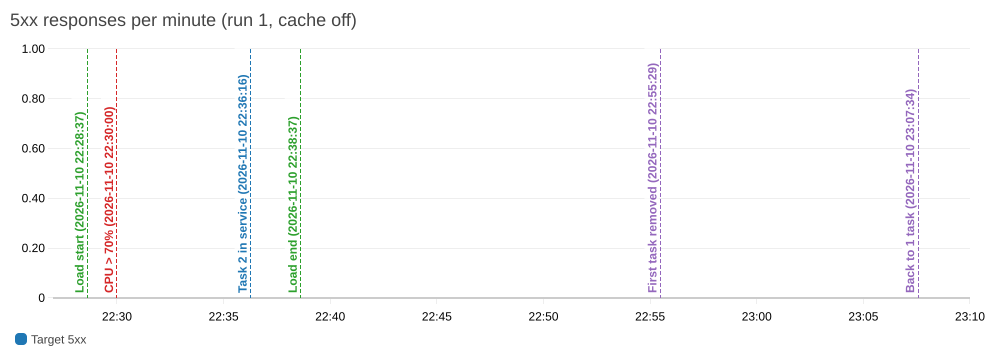
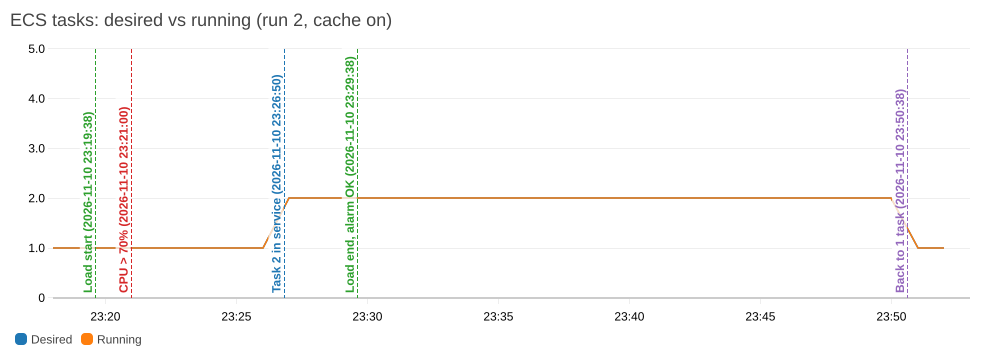
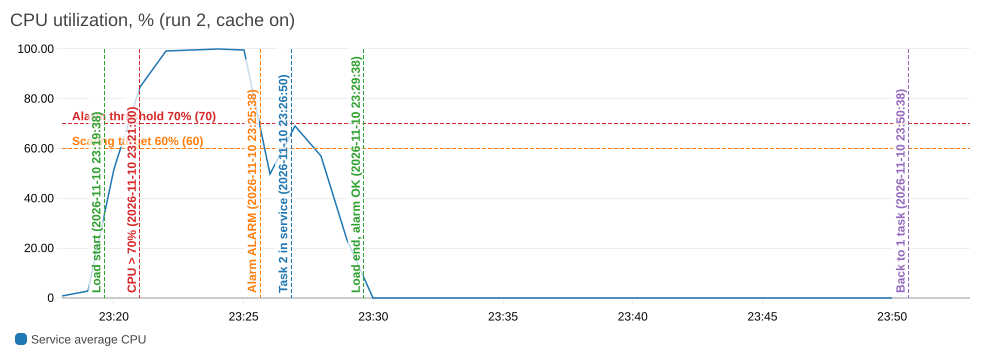
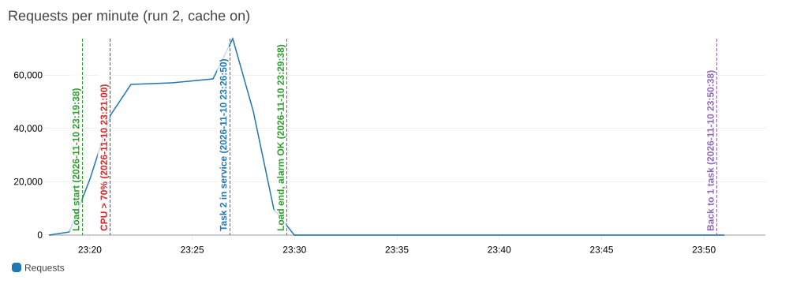
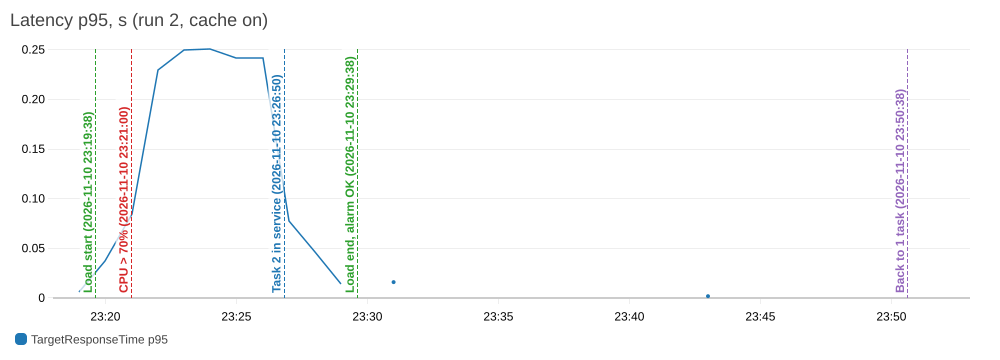
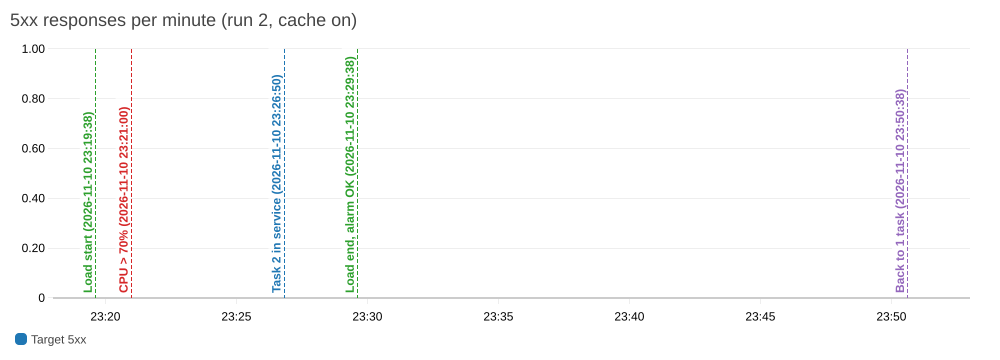

# Автоматичне масштабування

## Політика

Файл `infra/main/autoscaling.tf`: `aws_appautoscaling_target` для сервісу `cloude-tech-lab1-app` і
`aws_appautoscaling_policy` типу `TargetTrackingScaling`.

| Параметр | Значення | Змінна Terraform |
| --- | --- | --- |
| Метрика | `ECSServiceAverageCPUUtilization` - середній CPU усіх задач сервісу | - |
| Цільове значення | 60% | `autoscaling_cpu_target` |
| Мінімум задач | 1 | `autoscaling_min_capacity` |
| Максимум задач | 4 (validation не дає поставити більше) | `autoscaling_max_capacity` |
| Cooldown після додавання | 60 с | `autoscaling_scale_out_cooldown` |
| Cooldown після вилучення | 300 с | `autoscaling_scale_in_cooldown` |
| Розмір задачі | 0.25 vCPU, 512 МБ | `aws_ecs_task_definition.app` |

У `aws_ecs_service.app` в `ignore_changes` додано `desired_count`. Кількість задач тепер змінює автомасштабування,
і `terraform apply` не повертає її до `var.desired_count` (1).

Для кожної target tracking політики AWS сам створює два CloudWatch alarm (видно в `describe-alarms`):

| Alarm | Умова | Що робить |
| --- | --- | --- |
| `...-AlarmHigh-...` | CPU > 60% у 3 хвилинних точках поспіль | додає задачі |
| `...-AlarmLow-...` | CPU < 54% (90% від цілі) у 15 хвилинних точках поспіль | вилучає задачі |

Нову кількість політика рахує сама, приблизно пропорційно відхиленню CPU від цілі. Вгору вона округлює
агресивно (у прогоні 1 з 2 задач при ~70% CPU поставила одразу 4), вниз знімає обережно, по одній задачі.

## Чому ціль 60%

- Застосунок на Node.js виконує JavaScript в одному потоці. Задача має 0.25 vCPU, тому коли CPU доходить
  до 100%, запити стають у чергу і латентність росте різко. Калібрувальні прогони на 1 задачі
  ([loadtest/README.md](../loadtest/README.md)): за 21% CPU p95 на ALB - 2 мс, за 100% CPU і 200 VU - 46 мс,
  за 300 VU - 180 мс.
- Між перетином порогу і появою нової задачі минає кілька хвилин (розділ нижче). Ці хвилини наявні задачі
  мають витримати самі, тому потрібен запас. 60% лишає 40% до насичення.
- Нижча ціль (30-40%) дає більше простою і більше задач, за які треба платити. Вища (80-90%) майже не лишає
  запасу: поки додається задача, сервіс уже перевантажений.
- CPU тут чесний показник: у калібруванні RDS навантажений на 20%, а задача на 100%, тобто вузьке місце -
  CPU застосунку. Якби застосунок здебільшого чекав на базу, краще було б масштабувати за
  `ALBRequestCountPerTarget` або за латентністю.

## Період стабілізації (cooldown)

Cooldown - це час після масштабування, за який нові задачі мають запуститися і вплинути на метрику. Поки
cooldown триває, політика не реагує на ту саму ще не оновлену метрику повторно:

- scale-out cooldown (60 с): у цей період щойно додані задачі вже враховуються як наявні, тож наступне
  додавання рахується від нової кількості. Якщо навантаження ще росте, політика може додати задачі одразу
  після cooldown;
- scale-in cooldown (300 с): після вилучення наступне вилучення можливе лише через 5 хв. Якщо навантаження
  знову зросте, scale-out виконується одразу, cooldown на нього не впливає.

Чому такі значення. Нова задача Fargate стає в target group приблизно за 1-2 хв: запуск, старт Node.js,
2 health check по 15 с. Отже 60 с для scale-out - це мінімум, за який метрика починає змінюватися. 300 с
для scale-in разом із 15-хвилинним AlarmLow не дають знімати задачі через короткі провали навантаження.

Що буде, якщо cooldown дорівнює нулю:

- scale-out: поки нові задачі стартують, CPU лишається високим, alarm далі в стані ALARM, і політика щохвилини
  додає ще задачі. Сервіс проскакує одразу до максимуму (4), хоча вистачило б 2-3. Це перевитрата грошей;
- scale-in: задачі знімаються одна за одною без паузи. Після кожного вилучення CPU на решті росте, політика
  знову додає задачу, потім знову знімає. Виходить flapping: постійні старти й зупинки, холодні старти і
  обірвані з'єднання.

## Прогін з навантаженням (прогін 1, кеш вимкнено)

Сценарій із [LOADTEST.md](LOADTEST.md), N = 300 VU, 10 хв. Усі часи - UTC, 10.11.2026. Джерела: підсумок k6,
`aws cloudwatch describe-alarm-history`, `aws application-autoscaling describe-scaling-activities`, події
сервісу ECS, хвилинні метрики CloudWatch.

| Час | Подія |
| --- | --- |
| 22:28:37 | початок навантаження (наростання 0 → 300 VU) |
| 22:30 | перша хвилина з CPU вище обох порогів: 84.5% (у 22:31-22:35 - 99.7-99.9%) |
| 22:31:37 | початок сталого навантаження (300 VU) |
| 22:34:38 | alarm `ecs-cpu-high` перейшов у ALARM (лист) |
| 22:35:19 | AlarmHigh політики спрацював: desired 1 → 2 |
| 22:35:46 | ECS запустив другу задачу |
| 22:36:16 | друга задача зареєстрована в target group; 22:36:25 - сервіс у steady state |
| 22:36:37 | початок спаду навантаження |
| 22:38:19 | друге рішення політики: desired 2 → 4 (на основі CPU за 22:36-22:37) |
| 22:38:37 | кінець навантаження |
| 22:39:08 | 4 задачі працюють |
| 22:39:38 | alarm `ecs-cpu-high` повернувся в OK (лист) |
| 22:55:25 | AlarmLow спрацював: desired 4 → 3, задача зупинена о 22:55:29 |
| 23:01:25 | desired 3 → 2 |
| 23:07:25 | desired 2 → 1, о 23:07:43 сервіс знову на 1 задачі |

Хвилинні значення (CPU - середнє по сервісу, запити - сума за хвилину на ALB, p95 - `TargetResponseTime` на ALB):

| Хвилина | CPU, % | Desired / Running | Запитів за хв | p95, мс |
| --- | --- | --- | --- | --- |
| 22:29 | 34.7 | 1 / 1 | 21 594 | 5 |
| 22:30 | 84.5 | 1 / 1 | 45 246 | 55 |
| 22:31 | 99.9 | 1 / 1 | 52 015 | 169 |
| 22:32 | 99.9 | 1 / 1 | 49 292 | 370 |
| 22:33 | 99.9 | 1 / 1 | 48 460 | 365 |
| 22:34 | 99.8 | 1 / 1 | 47 983 | 388 |
| 22:35 | 99.7 | 1 / 1 | 47 703 | 370 |
| 22:36 | 67.3 | 2 / 1 | 58 764 | 289 |
| 22:37 | 70.3 | 2 / 2 | 46 752 | 24 |
| 22:38 | 11.9 | 2 / 2 | 9 646 | 13 |
| 22:39 | 1.6 | 4 / 3 | 0 | - |

### Знімки панелі

Графіки побудовані з тих самих метрик, що й dashboard `cloude-tech-lab1` (`terraform output dashboard_url`),
через `aws cloudwatch get-metric-widget-image` за вікно 22:27-23:10. Вертикальні лінії: початок
навантаження, перетин порогу CPU, поява другої задачі, кінець навантаження, вилучення першої задачі,
повернення до 1 задачі. На графіку CPU ще позначено переходи alarm у ALARM і OK.

Що видно на панелі:

- запити ростуть разом із VU, але вже з 22:31 упираються в ~48-52 тис. за хвилину: одна задача на 100% CPU
  більше не обробляє, і p95 росте з 5 до 370-388 мс;
- після появи другої задачі (22:36) запитів за хвилину стає більше (58 764), а p95 падає до 24 мс;
- 4 задачі з'являються вже після кінця навантаження і ще 16 хв стоять без роботи, потім по одній знімаються;
- `HTTPCode_Target_5XX_Count` весь час 0. 25 помилок у k6 - це 502 від самого ALB (`HTTPCode_ELB_502_Count`),
  див. [LOADTEST.md](LOADTEST.md).

### Чому між перетином порогу і появою задачі минає час

CPU перевищив поріг у хвилину 22:30, а друга задача почала приймати запити близько 22:36:30, тобто через
~6 хв. З чого це складається:

1. AlarmHigh потребує 3 хвилинних точок поспіль вище 60%: 22:30, 22:31, 22:32. Раніше 22:33:00 умова не може
   виконатися в принципі.
2. Метрика `AWS/ECS CPUUtilization` потрапляє в CloudWatch із запізненням, і alarm оцінюється раз на хвилину.
   Фактично політика спрацювала о 22:35:19, на ~2.3 хв пізніше за найраніший можливий момент.
3. ECS запускає задачу Fargate (виділення ресурсу, завантаження образу): 22:35:19 → 22:35:46, 27 с.
4. Старт Node.js, `createTable()`, реєстрація в target group: → 22:36:16, ще 30 с.
5. ALB починає слати трафік після 2 успішних health check з інтервалом 15 с, тобто ще до 30 с.

Ці 5-6 хв одна задача працювала на 100% CPU, тому ціль 60% має залишати запас.

З тієї ж причини виникло перемасштабування до 4. Рішення 22:38:19 спиралося на CPU за 22:36-22:37 (67-70%
на 2 задачах), коли навантаження ще було, а задачі з'явилися вже після кінця тесту. Політика завжди реагує
на минуле.

### Чому вилучення відбувається значно пізніше

Навантаження закінчилося о 22:38:37, CPU з 22:38 менше 54%, а перша задача знята о 22:55:29 (через ~17 хв).
Сервіс повернувся до 1 задачі о 23:07:43 (через ~29 хв):

1. AlarmLow потребує 15 хвилинних точок поспіль нижче 54% (22:38-22:52). AWS навмисно робить вилучення
   несиметричним: зайва задача коштує кілька центів, а передчасне вилучення під навантаженням - це
   перевантаження і помилки для користувачів.
2. Target tracking знімає задачі поступово, по одній, і після кожного вилучення діє scale-in cooldown 300 с.
   Звідси кроки 22:55 → 23:01 → 23:07 (кожен ~6 хв: cooldown плюс хвилинна оцінка alarm).

Що відбувається із запитами задачі, яку вилучають: ECS спочатку знімає її з target group (події
`deregistered 1 targets` і `has begun draining connections`). ALB перестає слати нові запити і 10 с
(`deregistration_delay`) чекає на завершення поточних. Потім ECS надсилає SIGTERM. Застосунок обробляє його
(`app/src/index.js`): `server.close()` не приймає нових з'єднань і чекає на поточні запити, потім закриває
пул PostgreSQL і клієнт Redis і завершується з кодом 0. Якщо за 10 с не встигне, вийде примусово, а ECS
через 30 с надіслав би SIGKILL. Без обробника Node.js як PID 1 проігнорував би SIGTERM, і задача висіла б до
SIGKILL.

## Прогін 2 (кеш увімкнено)

Той самий сценарій, N = 300. З кешем одна задача обробляє більше запитів, тому сервіс обійшовся 2 задачами.

| Час (UTC) | Подія |
| --- | --- |
| 23:19:38 | початок навантаження |
| 23:21 | перша хвилина з CPU вище 70%: 84.8% |
| 23:22:38 | початок сталого навантаження |
| 23:25:38 | alarm `ecs-cpu-high` у ALARM |
| 23:26:19 | AlarmHigh спрацював: desired 1 → 2 |
| 23:26:50 | друга задача зареєстрована в target group |
| 23:29:18 | AlarmHigh повернувся в OK: CPU на 2 задачах 49.7-69.3%, потім 57.2%, третя задача не знадобилася |
| 23:29:38 | кінець навантаження, alarm `ecs-cpu-high` в OK |
| 23:46:24 | AlarmLow у ALARM (15 точок нижче 54%, з 23:29) |
| 23:50:25 | desired 2 → 1 (наступний виклик політики після AlarmLow), задача зупинена о 23:50:38 |

Від кінця навантаження до вилучення задачі - 21 хв.

