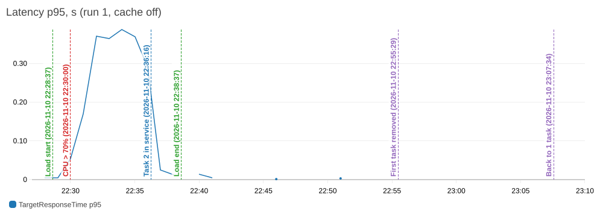
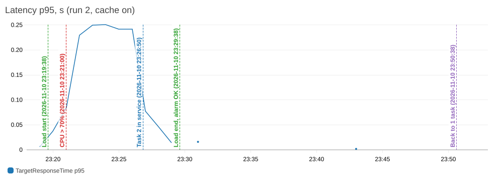
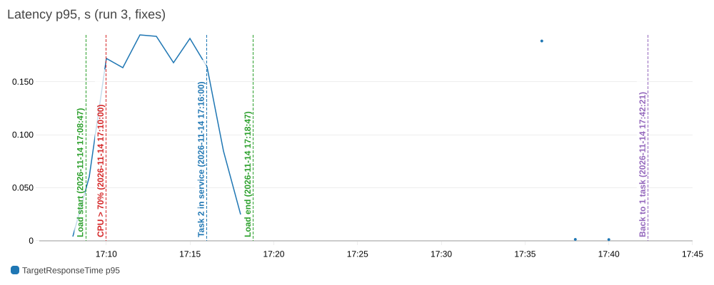
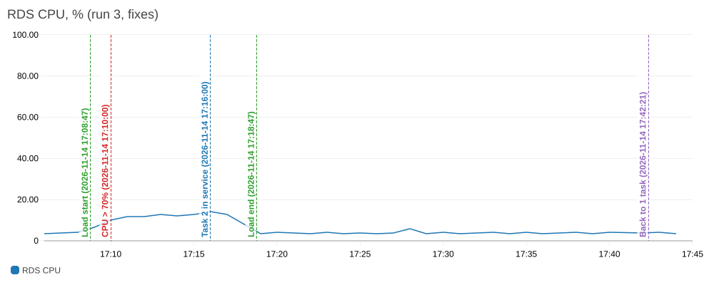

# Кешування операцій читання

## Що кешується і як

Найчастіше читання - `GET /tasks`: 4 з 10 запитів сценарію навантаження. Воно переведене на схему
cache-aside (`app/src/cache.js`, `app/src/routes.js`):

1. Застосунок читає ключ `tasks:recent` з Redis.
2. Якщо ключ є (TTL ще не сплив), повертає збережений JSON без звернення до бази: `X-Cache: HIT`.
3. Якщо ключа немає, читає з PostgreSQL останні 50 задач, повертає їх і записує JSON у Redis з
   TTL 30 с (`CACHE_TTL_SECONDS`): `X-Cache: MISS`.
4. `POST /tasks` і `DELETE /tasks/:id` після запису в базу видаляють ключ (інвалідація), тож наступне
   читання бере свіжі дані.

З прогону 3 так само кешується `GET /authors/:username` (TTL 5 с, без інвалідації), а одночасні промахи
об'єднуються в один запит до бази (single-flight). Обидва розділи - нижче.

Якщо кеш вимкнено (`CACHE_ENABLED=false`) або Redis недоступний, відповідь іде з бази з `X-Cache: BYPASS`
(fail-soft). Щоб недоступний Redis не гальмував запити:

- `disableOfflineQueue: true` - команди не стають у чергу, поки клієнт перепідключається;
- `commandOptions.timeout = 200` мс на кожну команду;
- перепідключення у фоні з паузою від 0.5 до 5 с.

Локально перевірено: після `docker stop` контейнера Redis `/tasks` віддає `BYPASS` за 3 мс, після
`docker start` клієнт сам перепідключається, і знову йдуть `MISS`/`HIT`.

## Redis в AWS

Керований ElastiCache не входить у Free Tier, тому Redis працює окремим ECS-сервісом
(`infra/main/redis.tf`):

- образ `public.ecr.aws/docker/library/redis:8.10.3-alpine` (остання стабільна версія на момент роботи),
  1 задача Fargate 0.25 vCPU / 512 МБ у приватних підмережах;
- без персистентності (`--save "" --appendonly no`), `--maxmemory 256mb --maxmemory-policy allkeys-lru`:
  це кеш, після рестарту він просто наповнюється заново;
- адреса через Cloud Map: приватний DNS-простір `cloude-tech-lab1.local`, сервіс `redis`, тобто
  `REDIS_URL=redis://redis.cloude-tech-lab1.local:6379`. ECS сам оновлює A-запис, коли задача
  перезапускається на іншій IP-адресі;
- security group `cloude-tech-lab1-redis-sg`: порт 6379 відкритий лише для security group застосунку.
  Пароля на Redis немає, доступ обмежений мережею;
- `deployment_minimum_healthy_percent = 0`, `deployment_maximum_percent = 100`: під час оновлення не
  буває двох Redis одночасно. Інакше різні задачі застосунку могли б підключитися до різних Redis, і
  інвалідація на одному не очистила б кеш на іншому. Кілька секунд без Redis застосунок переживає через
  `BYPASS`;
- логи в CloudWatch, група `/ecs/cloude-tech-lab1-redis`.

Кеш вмикається змінною Terraform `cache_enabled` (за замовчуванням `false`), вона потрапляє в task definition
як `CACHE_ENABLED`. Для прогону 2 у локальному `terraform.tfvars` додано `cache_enabled = true`, потім
`terraform apply` і `gh workflow run deploy.yml`. Деплой потрібен, бо CI бере останню ревізію task definition
і підставляє в неї свіжий образ, а сервіс ігнорує ревізію, яку реєструє Terraform. Перевірка:

```bash
curl -s -D - -o /dev/null http://<alb>/tasks | grep X-Cache
```

Перший запит дає `MISS`, наступні - `HIT`.

## Чому не кеш у пам'яті процесу

Під навантаженням сервіс працює на 2-4 задачах. Якби кожна задача мала власний кеш:

- `POST /tasks` очищав би кеш лише в тій задачі, яка його обробила. Інші задачі до 30 с віддавали б
  старий список, і клієнт, що щойно створив задачу, міг би її не побачити (запити розподіляє ALB);
- кожна задача прогрівала б свій кеш окремо, тож влучань менше, а звернень до бази більше;
- нова задача після scale-out стартує з порожнім кешем, а при scale-in кеш просто зникає.

Спільний Redis - одна копія даних для всіх задач. Інвалідація з будь-якої задачі одразу видна всім.

## Кеш даних автора (прогін 3)

Прогін 2 показав, що базу навантажує не список, а `GET /authors/:username`:
`SELECT COUNT(*), MAX(created_at) FROM tasks WHERE author = $1`. Індекс `tasks_author_idx` тут не допомагає,
бо всі задачі мають `author = admin`, і запит щоразу проходить усі рядки автора. Тому з прогону 3 ця
відповідь теж кешується в Redis (`app/src/authors.js`):

- ключ `author:<username>`, cache-aside, як для `GET /tasks`;
- TTL 5 с (`AUTHOR_CACHE_TTL_SECONDS`, змінна Terraform `author_cache_ttl_seconds`, за замовчуванням 5);
- без інвалідації на `POST`/`DELETE`. Кількість задач автора може відставати до 5 с, для статистики це
  нормально. У сценарії на кожен `GET /authors/admin` припадає один `POST /tasks` (~90 за секунду), тож
  інвалідація на кожен `POST` видаляла б ключ приблизно так само часто, як його читають, і частка влучань
  була б майже нуль;
- `X-Cache: HIT/MISS/BYPASS` і fail-soft такі самі, як у `GET /tasks`: якщо Redis недоступний, відповідь
  іде з бази з `BYPASS`.

Отже `COUNT(*)` виконується не частіше ніж раз на 5 с на кожен процес застосунку, незалежно від кількості
запитів. Вартість одного `COUNT(*)` і далі росте з таблицею, але кількість таких запитів більше не росте з
навантаженням.

## Single-flight: об'єднання одночасних промахів

У прогоні 2 частка HIT для списку була 53% проти теоретичних ~75%: після інвалідації кілька запитів
одночасно отримували MISS і кожен робив власний `SELECT` по той самий список (cache stampede). З прогону 3
обидва кешовані ендпоінти йдуть через `cache.getOrLoad()` (`app/src/cache.js`):

1. Читання ключа з Redis. HIT - відповідь одразу.
2. MISS або BYPASS: якщо в цьому процесі вже виконується читання з бази для того самого ключа, запит не
   робить свого `SELECT`, а чекає на той самий проміс. Така відповідь має заголовок
   `X-Cache-Coalesced: true`.
3. Інакше запит сам стає «ведучим»: читає з бази, записує результат у Redis (лише якщо був MISS) і віддає
   його всім, хто чекав.

Деталі:

- об'єднання працює в межах одного процесу (одна ECS-задача). На 2 задачах одночасно може бути до двох
  читань того самого ключа - по одному на задачу. Для повного об'єднання між задачами потрібен lock у
  Redis (`SET key NX PX`), але він додає ще один мережевий виклик на кожен MISS;
- `POST`/`DELETE` видаляють не лише ключ у Redis, а й запис про читання в процесі. Запит, що прийде після
  інвалідації, не приєднається до читання, яке почалося до запису, а ведучий такого старого читання не
  запише застарілий список у Redis. Це закриває гонку з розділу про застарілі дані в межах одного процесу;
- якщо читання з бази впало, помилку отримують усі, хто на нього чекав (500), і наступний запит пробує
  знову;
- об'єднання працює і з `BYPASS` (Redis недоступний), тобто при падінні Redis база отримує не кожен запит, а
  один на ключ на процес за раз.

Важливо: single-flight не збільшує частку `X-Cache: HIT`. Об'єднані запити теж отримали MISS у Redis, вони
лише не йдуть у базу. Тому в k6 є окремі метрики `tasks_list_coalesced` і `author_coalesced`, а
показник, який треба порівнювати з теоретичними ~75%, - частка запитів без власного `SELECT`
(HIT + об'єднані).

Локальна перевірка (docker compose): після закінчення TTL 100 одночасних `GET /authors/admin` дали 11 HIT,
2 MISS (ведучі) і 87 об'єднаних, тобто 2 запити `COUNT(*)` замість 89 (лічильник транзакцій у
`pg_stat_database`).

## Порівняння: без кешу, з кешем і після виправлень

Однаковий сценарій ([LOADTEST.md](LOADTEST.md)): N = 300 VU, 3 + 5 + 2 хв, сервіс стартує з 1 задачі.
Прогін 1 - `cache_enabled = false` (`X-Cache: BYPASS`), прогін 2 - `cache_enabled = true`, прогін 3 - кеш
увімкнено плюс кеш даних автора, single-flight і `keepAliveTimeout` 65 с. Перед прогонами 2 і 3 задачі,
створені попереднім прогоном, видалено через `DELETE /tasks/:id`. Так усі три прогони стартували з 18 811
задач у таблиці: `GET /authors/:username` рахує `COUNT(*)`, і його вартість залежить від розміру таблиці.

| Показник | Без кешу (прогін 1) | З кешем (прогін 2) | Прогін 3 |
| --- | --- | --- | --- |
| Латентність p95, усі запити (k6) | 333.2 мс | 241.0 мс | 182.7 мс |
| Латентність p95, `GET /tasks` (k6) | 331.3 мс | 251.2 мс | 194.4 мс |
| Латентність p95, `GET /authors/:username` (k6) | 364.7 мс | 251.1 мс | 127.3 мс |
| Латентність p50, усі запити (k6) | 112.4 мс | 45.4 мс | 56.2 мс |
| p95 на ALB, сталі хвилини на 1 задачі | 365-388 мс | 242-251 мс | 163-194 мс |
| Запитів за секунду, середнє за 10 хв | 713.3 | 805.9 | 827.0 |
| Запитів за хвилину, 1 задача на 100% CPU | 47 703-52 015 | 56 540-58 557 | 62 066-63 005 |
| Усього запитів / помилок | 428 800 / 25 | 484 359 / 2 | 497 681 / 0 |
| HIT `GET /tasks` | 0 | 53.0% | 40.6% |
| Об'єднані `GET /tasks` (single-flight) | - | - | 46.3% |
| `GET /tasks` без власного `SELECT` | 0 | 53.0% | 86.9% |
| HIT `GET /authors/:username` | - | - | 98.8% |
| `COUNT(*)` за прогін | 42 881 | 48 436 | 148 |
| Запитів до бази (розрахунок, див. нижче) | 428 799, 714.7 за с | 381 597, 636.0 за с | 275 104, 458.5 за с |
| Запитів до бази на один цикл VU | 10 | 7.88 | 5.53 |
| RDS CPU на сталому навантаженні, середнє / макс | 40.6% / 46.3% | 44.8% / 53.8% | 12.3% / 12.9% |
| RDS ReadIOPS, середнє | 0.40 | 0.46 | 0.43 |
| RDS DatabaseConnections, середнє / макс | 10 / 10 | 12 / 20 | 10.2 / 11 |
| Максимум задач | 4 | 2 | 2 |

Запити до бази пораховані з підсумків k6: кожен запит застосунку робить рівно один SQL-запит, крім
відповідей з `X-Cache: HIT` і об'єднаних (`X-Cache-Coalesced: true`). Тобто запитів до бази = усі запити -
1 логін - влучання в кеш - об'єднані. На цикл припадає 4 `GET /tasks` і 1 `GET /authors/:username`.
Метрики RDS на сталому навантаженні - п'ять хвилин від хвилини початку сталої фази.

### Частка влучань

`tasks_list_cache_hit` у прогоні 2 - **53.0%**: 102 761 з 193 744 запитів `GET /tasks` віддані з Redis.

Чому не 90%+: на кожен цикл VU припадає 1 `POST /tasks`, а він видаляє ключ. На сталому навантаженні це
~90 інвалідацій за секунду і ~4 читання списку між двома інвалідаціями. Перше читання після інвалідації -
завжди MISS, тож теоретична межа ~75%. Реально менше, бо кілька одночасних запитів встигають отримати MISS,
поки перший ще не записав результат у Redis.

### Що це дало

- Одна задача з кешем обробляє на ~17% більше запитів (57 тис. проти 49 тис. за хвилину на 100% CPU):
  на HIT застосунок віддає готовий JSON-рядок без запиту до PostgreSQL, розбору 50 рядків і
  `JSON.stringify`.
- Через це менша черга на перевантаженій задачі: p50 упав з 112 до 45 мс, p95 - з 333 до 241 мс.
- Після появи другої задачі CPU швидше опустився нижче цілі, і політика не додала 3-4 задачі, як у прогоні 1.
- Запитів до бази стало на 21% менше на цикл (7.88 замість 10).

Чого кеш не дав: CPU бази не впав, а навіть виріс (44.8% проти 40.6%). CPU RDS у межах кожного прогону росте
хвилина за хвилиною разом із таблицею (прогін 1: 36 → 46%, прогін 2: 35 → 54%). Отже основне навантаження на
базу - не список (індекс за первинним ключем, `LIMIT 50`), а `COUNT(*)` у `GET /authors/:username`, який
читає всі задачі автора. Прогін 2 зробив на 13% більше циклів (48 436 проти 42 881): більше вставок, більше
`COUNT(*)` і більша таблиця під кінець (67 245 проти 61 690 задач). Висновок: кешувати варто те, що дорого
бази коштує. Тут більше дало б кешування або окремий лічильник для даних автора, ніж кешування списку.

### Прогін 3: кеш авторів і single-flight

- **База.** RDS CPU на сталому навантаженні впав з 44.8% до 12.3% і більше не росте разом із таблицею
  (11.8 → 12.7% за сталу фазу проти 35.0 → 53.8%). `COUNT(*)` - 148 разів за прогін замість 48 436.
  Це підтверджує висновок прогону 2: базу навантажував саме `GET /authors/:username`.
- **Single-flight.** 46.3% `GET /tasks` дочекались чужого читання. Без власного `SELECT` обійшлись 86.9%
  читань списку (прогін 2 - 53.0%), `SELECT` для списку - 26 116 замість 90 983. Запитів до бази на цикл -
  5.53 замість 7.88; менше 5 бути не може, бо `POST /tasks` і `GET /tasks/:id` не кешуються.
- **Що погіршилось.** Частка `X-Cache: HIT` для списку впала з 53.0% до 40.6%. Single-flight її не
  підіймає за визначенням (об'єднаний запит теж отримав MISS), а падіння, найімовірніше, дав захист від
  застарілих даних: `POST` скасовує читання, яке вже йде в процесі, і його результат не записується в Redis.
  При ~90 `POST` за секунду на задачі зі 100% CPU таких скасованих читань багато, і ключ частіше лишається
  порожнім. У прогоні 2 ці записи потрапляли в Redis і рахувались як HIT, хоча могли не містити щойно
  створеної задачі. p50 усіх запитів теж виріс (45.4 → 56.2 мс): миттєвих HIT для списку менше, а
  об'єднаний запит чекає на ведучого. Докладніше - у [ITERATIONS.md](ITERATIONS.md).

## Скільки часу клієнт бачить застарілі дані

Ключ видаляється після запису в базу і до відповіді на `POST`/`DELETE`. Тому наступне читання - вже MISS зі
свіжими даними, і зазвичай застарілих даних клієнт не бачить зовсім. Винятки:

1. Гонка: запит A прочитав список з бази до коміту запису B, B видалив ключ, а A записав у Redis старий
   список уже після видалення. Такий запис живе до кінця TTL. З прогону 3 у межах одного процесу цієї
   гонки немає (інвалідація скасовує поточне читання, див. single-flight), але вона лишається, коли A і B
   обробляють різні задачі ECS.
2. Redis недоступний або не відповів за 200 мс у момент інвалідації: ключ не видалено (fail-soft), стара
   версія живе до кінця TTL.

Верхня межа - TTL, тобто **до 30 с** (`CACHE_TTL_SECONDS`). Дані автора не інвалідуються зовсім, тому
для них застарілість - завжди до 5 с (`AUTHOR_CACHE_TTL_SECONDS`). Без інвалідації клієнт бачив би застарілий
список завжди до 30 с після кожної зміни.

Як зменшити:

- менший TTL (наприклад, 5-10 с): менше вікно застарілості, але більше MISS і запитів до бази;
- повторне видалення ключа через ~1 с після запису (delayed double delete) - прибирає записи з гонки;
- оновлювати кешований список у тому самому запиті, що й запис (write-through), а не лише видаляти;
- версійні ключі: номер версії збільшується при записі, і старий список, записаний із запізненням,
  ніхто вже не прочитає.

## TTL і cache stampede

TTL 30 с тут - запобіжник на випадок пропущеної інвалідації. Актуальність забезпечує саме інвалідація. TTL
в 1 с означав би майже суцільні MISS при невеликому трафіку і додаткові запити до бази. TTL в 1 год -
годину застарілих даних після кожної пропущеної інвалідації.

Cache stampede - коли ключ зникає (TTL або інвалідація) і багато запитів одночасно отримують MISS та йдуть у
базу за тим самим результатом. У прогоні 2 це було видно як «втрачені» влучання (53% замість ~75%), з
прогону 3 застосунок об'єднує такі промахи в межах процесу (розділ про single-flight вище). Для дешевого
запиту зі списком це не страшно, але для дорогого це лавина на базу. Як уникнути: в одному процесі
об'єднувати однакові запити (single-flight), брати короткий lock у Redis (`SET key NX PX`), щоб базу читав
лише один, віддавати старе значення, поки один запит його оновлює (stale-while-revalidate), додавати
випадковий розкид до TTL.

## Графіки

Латентність p95 на ALB: без кешу 365-388 мс на перевантаженій задачі, з кешем 242-251 мс.





Прогін 3: p95 163-194 мс на одній задачі, CPU RDS 12-14% за весь прогін.





Повні набори графіків прогонів 1-2 - у [AUTOSCALING.md](AUTOSCALING.md), прогону 3 - у
[ITERATIONS.md](ITERATIONS.md).
