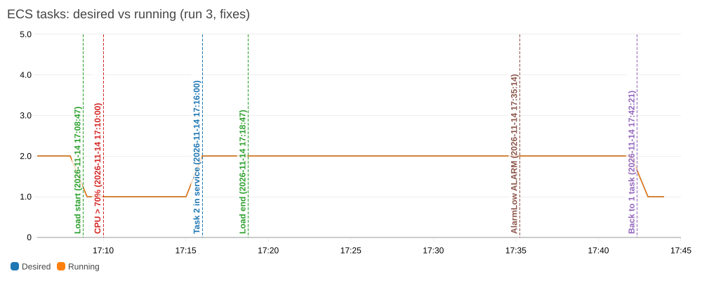
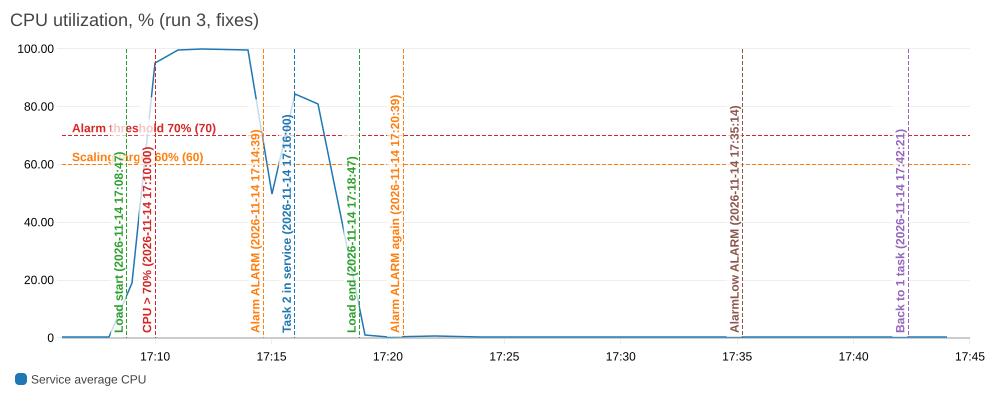
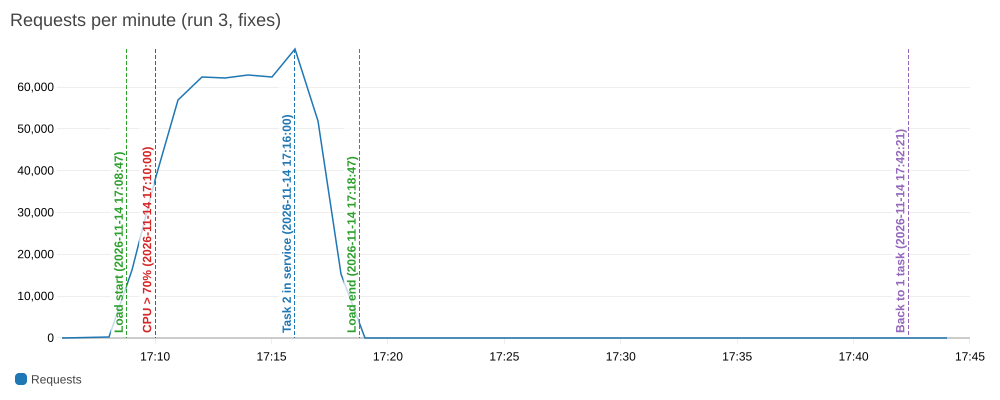
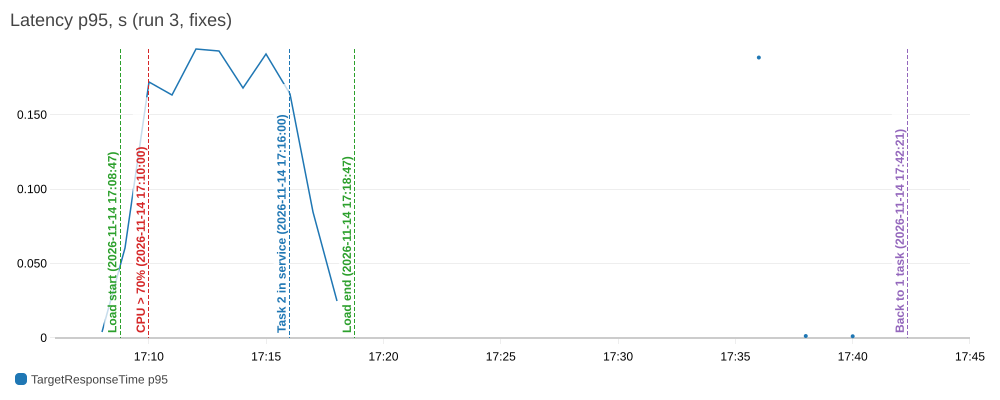
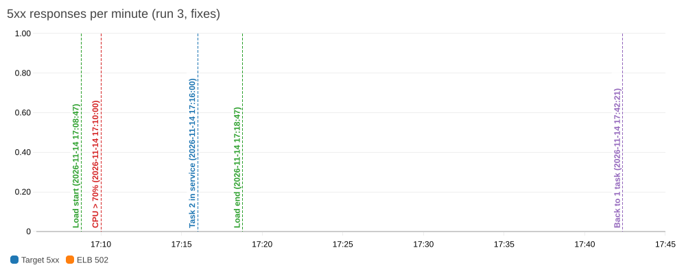
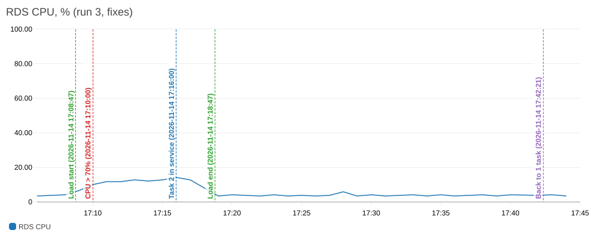

# Ітерації навантажувального тестування

Усі прогони - один і той самий сценарій k6 ([LOADTEST.md](LOADTEST.md)): кожен VU у циклі робить
1 `POST /tasks`, 4 `GET /tasks`, 4 `GET /tasks/:id` і 1 `GET /authors/admin`, пауза між запитами
0.2 с ± 50%. Сервіс: ECS Fargate 0.25 vCPU / 512 МБ, 1-4 задачі, ціль CPU 60%, RDS db.t4g.micro, Redis
окремим ECS-сервісом. Часи - UTC.

## Ітерація 0. Калібрування: 30, 200 і 300 VU (10.11.2026)

**Що виміряли.** Три короткі прогони на 1 задачі (`loadtest/results/calib-*.json`), щоб підібрати N для
основних прогонів.

| Прогін | N | Фази | Запитів за хв на сталому навантаженні | CPU задачі | p95 на ALB | p95 у k6 | Помилок |
| --- | --- | --- | --- | --- | --- | --- | --- |
| calib-1 | 30 | 30 с / 2 хв / 10 с | 7 982 | 21% | 2 мс | 26.4 мс | 0 |
| calib-2 | 200 | 30 с / 1.5 хв / 10 с | 50 449 | 99.9% | 46 мс | 69.8 мс | 0 |
| calib-3 | 300 | 30 с / 1 хв / 10 с | 50 566 | 87-100% | 180 мс | 200.6 мс | 3 |

**Що побачили.** Одна задача впирається в 100% CPU на ~840 запитах/с, далі запити стають у чергу і
латентність росте. RDS при цьому завантажений на ~20%, тобто вузьке місце - CPU застосунку. З 30 VU
p50 у k6 - 24.8 мс при p95 на ALB 2 мс, отже ~23 мс - це мережа від ноутбука до eu-central-1.

**Рішення.** N = 300. Один VU дає ~4.4 запита/с, 300 VU - ~1 330 запитів/с, це ~1.6 задачі на 100% CPU
або 3 задачі при цілі 60%. Так одна задача гарантовано перевантажена, і масштабування мусить спрацювати,
але потрібна кількість задач не впирається в максимум 4.

**Що змінилось далі.** Основні прогони - 10 хв (3 / 5 / 2 хв), N = 300, сервіс стартує з 1 задачі.

## Ітерація 1. Прогін 1 без кешу (10.11.2026, 22:28:37 - 22:38:37)

**Що виміряли.** `cache_enabled = false`, усі `GET /tasks` - `X-Cache: BYPASS`. У таблиці на старті 18 811
задач.

**Що побачили.**

- 428 800 запитів, 713.3 запиту/с, p50 112.4 мс, p95 333.2 мс. Майже всю сталу фазу сервіс був на одній
  задачі зі 100% CPU (22:31-22:35, 47-52 тис. запитів за хв), p95 на ALB 365-388 мс - це черга на єдиному
  потоці Node.js.
- Друга задача з'явилась о 22:36:16, через 4 хв 39 с після початку сталої фази. Рішення 22:38:19 (2 → 4)
  спиралось на CPU ще під навантаженням, і 4 задачі з'явились уже після кінця тесту.
- 25 помилок - усі 502 від самого ALB (`HTTPCode_ELB_502_Count` 4 + 20 + 1 у 22:31-22:33), а
  `HTTPCode_Target_5XX_Count` = 0. Застосунок 5xx не повертав. Підозра: Node.js закриває keep-alive через
  5 с, а ALB тримає з'єднання до 60 с і іноді шле запит у з'єднання, яке ціль саме закриває.
- 10 запитів до бази на цикл VU, RDS CPU 40.6% у середньому на сталому навантаженні і росте хвилина за
  хвилиною (36 → 46%) разом із таблицею, яка за прогін виросла на 42 879 рядків.

**Рішення.** За планом лабораторної ввімкнути кеш `GET /tasks` (найчастіше читання, 4 з 10 запитів) і
повторити той самий прогін. Застосунок між прогонами не міняти, навіть очевидне виправлення keep-alive,
щоб різниця між прогонами пояснювалась лише кешем. Задачі прогону 1 видалити через `DELETE /tasks/:id`,
щоб прогін 2 стартував з тих самих 18 811 рядків: вартість `COUNT(*)` у `GET /authors/:username` залежить
від розміру таблиці.

**Що змінилось далі.** `cache_enabled = true`, cache-aside для `GET /tasks` з TTL 30 с та інвалідацією на
`POST`/`DELETE` ([CACHE.md](CACHE.md)).

## Ітерація 2. Прогін 2 з кешем (10.11.2026, 23:19:38 - 23:29:38)

**Що виміряли.** Той самий сценарій, кеш увімкнено, старт з 18 811 задач.

**Що побачили.**

- 484 359 запитів (+13%), 805.9 запиту/с, p50 45.4 мс, p95 241.0 мс. Одна задача на 100% CPU обробляла
  56.5-58.6 тис. запитів за хв замість 47.7-52.0 тис.: на HIT застосунок віддає готовий JSON-рядок.
  Вистачило 2 задач замість 4.
- Частка HIT для `GET /tasks` - 53.0% проти теоретичних ~75% (90 інвалідацій за секунду, ~4 читання списку
  між ними, перше після інвалідації - завжди MISS). Різницю з'їдає cache stampede: кілька одночасних
  MISS ідуть у базу по той самий список, поки перший не записав його в Redis.
- Запитів до бази на цикл - 7.88 замість 10, але RDS CPU не впав, а виріс: 44.8% проти 40.6% у середньому
  і 35 → 54% протягом прогону. Отже базу навантажує не список (індекс за первинним ключем, `LIMIT 50`), а
  `COUNT(*)` у `GET /authors/:username`. Індекс `tasks_author_idx` не допомагає: усі задачі мають
  `author = admin`, тож запит щоразу проходить усі рядки, і чим більша таблиця, тим він дорожчий. Прогін 2
  зробив більше циклів, тобто більше вставок і більше `COUNT(*)` по більшій таблиці.
- 502 від ALB лишились (по одній о 23:21 і 23:27), `HTTPCode_Target_5XX_Count` = 0.

**Рішення.** Три виправлення, кожне - окремим комітом:

1. `server.keepAliveTimeout = 65000`, `server.headersTimeout = 66000` - довше за idle timeout ALB (60 с),
   тож закривати keep-alive з'єднання першим буде ALB, а не ціль. Очікування: `HTTPCode_ELB_502_Count` = 0.
2. Кеш `GET /authors/:username` у Redis, ключ `author:<username>`, TTL 5 с, без інвалідації. Статистиці
   автора нормально бути застарілою на кілька секунд, а інвалідація на кожен `POST` (~90/с) звела б
   частку влучань майже до нуля. Очікування: `COUNT(*)` не частіше ніж раз на 5 с на процес, RDS CPU
   перестає рости разом із таблицею.
3. Single-flight у межах процесу для `GET /tasks` і `GET /authors/:username`: поки один запит читає з
   бази, інші такі самі запити чекають на його проміс замість власного `SELECT`. Очікування: менше
   запитів до бази на цикл.

У k6 додано частку HIT для авторів (`author_cache_hit`) і частки об'єднаних запитів, сценарій і N не
змінювались. Перед прогоном 3 задачі прогону 2 видалено тим самим способом, таблиця знову має 18 811 рядків.

## Ітерація 3. Прогін 3 з виправленнями (14.11.2026, 17:08:47 - 17:18:47)

**Що виміряли.** Той самий сценарій і N = 300, кеш увімкнено, старт з 1 задачі і 18 811 задач у таблиці.
Застосунок - коміт `c817907` (ревізія task definition 21). Підсумок k6: `loadtest/results/run-3-fixes.json`.

Підготовка теж дала дані. Видалення 48 434 задач прогону 2 через API (8 паралельних `DELETE`, ~224 запити/с,
16:42-16:46) завантажило задачу на 76-81% CPU: кожен `DELETE` перевіряє JWT. Спрацювали `ecs-cpu-high`
(16:48:39) і AlarmHigh, політика додала другу задачу (16:49:23). Прогін почався лише після того, як сервіс
сам повернувся до 1 задачі: AlarmLow о 17:04:14, desired 2 → 1 о 17:08:14, задача знята з target group о
17:08:29. Наступного разу таке очищення варто робити повільніше або напряму в базі.

**Хронологія.**

| Час | Подія |
| --- | --- |
| 17:08:47 | початок навантаження (наростання 0 → 300 VU) |
| 17:10 | перша хвилина з CPU вище обох порогів: 95.2% |
| 17:11:47 | початок сталого навантаження |
| 17:14:39 | alarm `ecs-cpu-high` у ALARM (через 2 хв 52 с після початку сталої фази) |
| 17:15:23 | AlarmHigh: desired 1 → 2 |
| 17:16:00 | друга задача зареєстрована в target group (через 4 хв 13 с після початку сталої фази) |
| 17:16:47 | початок спаду |
| 17:18:23 | AlarmHigh в OK, третя задача не знадобилась |
| 17:18:39 | alarm `ecs-cpu-high` в OK |
| 17:18:47 | кінець навантаження |
| 17:20:39 - 17:21:39 | `ecs-cpu-high` ще раз пройшов ALARM і OK (пояснення нижче) |
| 17:35:14 | AlarmLow у ALARM (15 точок нижче 54%, 17:18-17:32) |
| 17:42:14 | desired 2 → 1, задача зупинена о 17:42:21 і знята з target group о 17:42:32 |

Хвилинні значення (CPU - середнє по сервісу, запити і помилки - сума за хвилину на ALB, p95 -
`TargetResponseTime` на ALB, RDS - середнє за хвилину):

| Хвилина | CPU, % | Desired / Running | Запитів за хв | p95, мс | ELB 502 | Target 5xx | RDS CPU, % | З'єднань з БД |
| --- | --- | --- | --- | --- | --- | --- | --- | --- |
| 17:09 | 18.97 | 1 / 1 | 16 333 | 61 | 0 | 0 | 6.65 | 10 |
| 17:10 | 95.2 | 1 / 1 | 37 779 | 172 | 0 | 0 | 10.05 | 10 |
| 17:11 | 99.79 | 1 / 1 | 56 924 | 163 | 0 | 0 | 11.82 | 10 |
| 17:12 | 99.86 | 1 / 1 | 62 448 | 194 | 0 | 0 | 11.91 | 10 |
| 17:13 | 99.86 | 1 / 1 | 62 066 | 193 | 0 | 0 | 12.87 | 10 |
| 17:14 | 99.72 | 1 / 1 | 63 005 | 168 | 0 | 0 | 12.1 | 10 |
| 17:15 | 49.94 | 1 / 1 | 62 511 | 191 | 0 | 0 | 12.7 | 11 |
| 17:16 | 84.46 | 2 / 2 | 69 114 | 164 | 0 | 0 | 14.28 | 20 |
| 17:17 | 80.81 | 2 / 2 | 51 988 | 85 | 0 | 0 | 12.76 | 20 |
| 17:18 | 42.2 | 2 / 2 | 15 271 | 25 | 0 | 0 | 8.13 | 2 |
| 17:19 | 1.05 | 2 / 2 | 0 | - | 0 | 0 | 3.61 | 1 |

CPU 49.94% у хвилину 17:15 - не реальне падіння навантаження (запитів за цю хвилину 62 511, як і до того).
Найімовірніше, о 17:15:31 стартувала друга задача, і середнє по сервісу за цю хвилину враховує її майже
нульовий CPU (у прогоні 2 те саме: 49.71% о 23:26).
Через цю точку `ecs-cpu-high` о 17:18:39 перейшов в OK, а коли надійшли точки 17:16-17:17 (84.5% і 80.8%),
о 17:20:39 знову в ALARM і о 17:21:39 остаточно в OK. Тобто в прогоні 3 alarm двічі пройшов ALARM → OK і
надіслав у SNS чотири сповіщення замість двох. Від кінця навантаження до вилучення другої задачі - 23.5 хв (прогін 2 - 21 хв): AlarmLow
спрацював о 17:35:14, а саме рішення політики настало лише о 17:42:14.

**Що побачили.**

- Помилок 0 з 497 681 запиту. `HTTPCode_ELB_502_Count` і `HTTPCode_Target_5XX_Count` за весь прогін не
  мають жодної точки, тобто 0. У прогонах 1 і 2 було 25 і 2 таких 502. Виправлення keep-alive спрацювало, як
  очікувалось.
- Кеш авторів: 98.8% `GET /authors/admin` - HIT, ще 0.9% дочекались чужого запиту. `COUNT(*)` виконано 148
  разів за 10 хв замість 48 436. RDS CPU на сталому навантаженні - 12.3% у середньому замість 44.8%, і він
  більше не росте разом із таблицею: 11.8 → 12.7% за сталу фазу (у прогоні 2 - 35.0 → 53.8%), хоча таблиця
  за прогін виросла на 49 768 рядків. Пік RDS CPU за весь прогін - 14.3% (прогони 1 і 2 - 61.1% і 72.6%).
- Запитів до бази - 5.53 на цикл (275 104 за прогін, 458.5 за с) проти 7.88 у прогоні 2 і 10 у прогоні 1.
  Нижче 5 не буває: `POST /tasks` і 4 `GET /tasks/:id` не кешуються.
- Single-flight: 46.3% `GET /tasks` не робили власного `SELECT`, а дочекались ведучого. Разом із HIT
  86.9% читань списку обійшлись без свого запиту до бази (у прогоні 2 - 53.0%), `SELECT` для списку -
  26 116 замість 90 983. Це більше за теоретичні ~75% з прогону 2: та оцінка рахувала один MISS на кожну
  інвалідацію, а тепер кілька інвалідацій поспіль, поки триває одне читання, теж обходяться одним
  `SELECT` на процес.
- Одна задача на 100% CPU обробляла 62.0-63.0 тис. запитів за хв (17:12-17:15) проти 56.5-58.6 тис. у
  прогоні 2 і 47.7-52.0 тис. у прогоні 1. p95 на ALB у хвилини 17:11-17:15 - 163-194 мс проти 242-251 мс.
- p95 у k6 - 182.7 мс (прогін 2 - 241.0 мс), p90 - 122.9 мс (201.1 мс). Усього 497 681 запит (+2.8%),
  827.0 запиту/с.
- Масштабування: як і в прогоні 2, вистачило 2 задач. Друга задача стала в target group через 4 хв 13 с
  після початку сталої фази (прогін 2 - 4 хв 12 с): цю затримку визначають alarm і старт Fargate, а не
  застосунок.

**Що не покращилось.**

- Частка `X-Cache: HIT` для `GET /tasks` впала з 53.0% до 40.6%. Single-flight сам по собі її не підіймає:
  об'єднані запити теж отримали MISS у Redis. Падіння, найімовірніше, - ціна захисту від застарілих даних.
  Тепер `POST` скасовує читання, яке вже йде в цьому процесі, і ведучий такого читання не записує
  результат у Redis. На одній задачі ~90 `POST` за секунду, тобто інвалідація кожні ~11 мс, а читання на
  процесі зі 100% CPU часто триває довше. Тоді ключ лишається порожнім, і наступне читання - знову MISS.
  У прогоні 2 такі запізнілі записи потрапляли в Redis і давали HIT, але зі списком, у якому могло не бути
  щойно створеної задачі. Для бази важливіше, скільки читань обходяться без власного `SELECT`, і це число
  виросло з 53.0% до 86.9%.
- p50 у k6 виріс з 45.4 до 56.2 мс, p99 - з 310.8 до 338.3 мс, максимум - з 692 до 1 188 мс. На сталій
  фазі одна задача так само працювала на 100% CPU, але обробляла на ~9% більше запитів від тих самих 300 VU,
  а миттєвих HIT для списку стало менше: об'єднаний запит чекає, поки ведучий прочитає з бази (p50
  `GET /tasks` - 56.9 мс проти 34.0 мс). Розподіл латентності став щільнішим: середина трохи повільніша,
  p90/p95 - коротші. Максимум у всіх чотирьох ендпоінтів майже однаковий (1 170-1 188 мс), тобто це одна
  пауза, яка зачепила всі запити водночас, а не повільний ендпоінт. На хвилинному p95 ALB її не видно,
  причину не встановлено.
- CPU застосунку, як і раніше, впирається в 100% на одній задачі, і масштабування реагує за ті самі ~4 хв.
  Кеш зменшив роботу на запит, але не прибрав вузьке місце - 0.25 vCPU на один потік Node.js.

**Висновок.** Усі три цілі досягнуто: 502 зникли, навантаження на базу більше не залежить від розміру
таблиці, одночасні промахи не множать запити до бази. Наступне вузьке місце - CPU задачі застосунку. Далі
можна збільшити задачу до 0.5 vCPU, знизити ціль масштабування, щоб друга задача з'являлась раніше, або
масштабувати за `ALBRequestCountPerTarget`.

### Знімки панелі

Графіки з тих самих метрик, що й dashboard `cloude-tech-lab1`, через `aws cloudwatch get-metric-widget-image`.
На графіку 5xx додано `HTTPCode_ELB_502_Count`, окремий графік - CPU RDS. Вертикальні лінії: початок
навантаження, перша хвилина з CPU > 70%, ALARM, поява другої задачі, кінець навантаження, повернення до
1 задачі.

## Три прогони поруч

| Показник | Прогін 1 (без кешу) | Прогін 2 (кеш списку) | Прогін 3 (виправлення) |
| --- | --- | --- | --- |
| Дата, час (UTC) | 10.11, 22:28:37 - 22:38:37 | 10.11, 23:19:38 - 23:29:38 | 14.11, 17:08:47 - 17:18:47 |
| Ітерацій VU | 42 881 | 48 436 | 49 768 |
| Запитів | 428 800 | 484 359 | 497 681 |
| Запитів за с (середнє за 10 хв) | 713.3 | 805.9 | 827.0 |
| Помилок у k6 | 25 | 2 | 0 |
| `HTTPCode_ELB_502_Count` | 25 | 2 | 0 |
| `HTTPCode_Target_5XX_Count` | 0 | 0 | 0 |
| p50, k6 | 112.4 мс | 45.4 мс | 56.2 мс |
| p90, k6 | 191.1 мс | 201.1 мс | 122.9 мс |
| p95, k6 | 333.2 мс | 241.0 мс | 182.7 мс |
| p99, k6 | 446.2 мс | 310.8 мс | 338.3 мс |
| Максимум, k6 | 2 573 мс | 692 мс | 1 188 мс |
| p95 на ALB, сталі хвилини на 1 задачі | 365-388 мс | 242-251 мс | 163-194 мс |
| Запитів за хв, 1 задача на 100% CPU | 47 703-52 015 | 56 540-58 557 | 62 066-63 005 |
| HIT `GET /tasks` | 0 (`BYPASS`) | 53.0% | 40.6% |
| Об'єднані `GET /tasks` | - | - | 46.3% |
| `GET /tasks` без власного `SELECT` | 0 | 53.0% | 86.9% |
| HIT `GET /authors/:username` | - | - | 98.8% |
| `COUNT(*)` за прогін | 42 881 | 48 436 | 148 |
| Запитів до бази за прогін / за с | 428 799 / 714.7 | 381 597 / 636.0 | 275 104 / 458.5 |
| Запитів до бази на цикл VU | 10 | 7.88 | 5.53 |
| RDS CPU на сталому навантаженні, середнє / макс | 40.6% / 46.3% | 44.8% / 53.8% | 12.3% / 12.9% |
| RDS CPU, перша → остання хвилина сталої фази | 36.1 → 46.3% | 35.0 → 53.8% | 11.8 → 12.7% |
| RDS CPU, пік за прогін | 61.1% | 72.6% | 14.3% |
| RDS DatabaseConnections на сталому навантаженні, середнє / макс | 10 / 10 | 12 / 20 | 10.2 / 11 |
| RDS ReadIOPS на сталому навантаженні, середнє | 0.40 | 0.46 | 0.43 |
| Друга задача в target group після початку сталої фази | 4 хв 39 с | 4 хв 12 с | 4 хв 13 с |
| Максимум задач | 4 | 2 | 2 |

Метрики RDS на сталому навантаженні - п'ять хвилин від хвилини початку сталої фази (22:31-22:35,
23:22-23:26, 17:11-17:15). Запити до бази пораховані з підсумків k6: кожен запит застосунку робить рівно
один SQL-запит, крім HIT і об'єднаних; `GET /tasks` - 4 на цикл, `GET /authors/:username` - 1 на цикл,
плюс один логін без бази.
