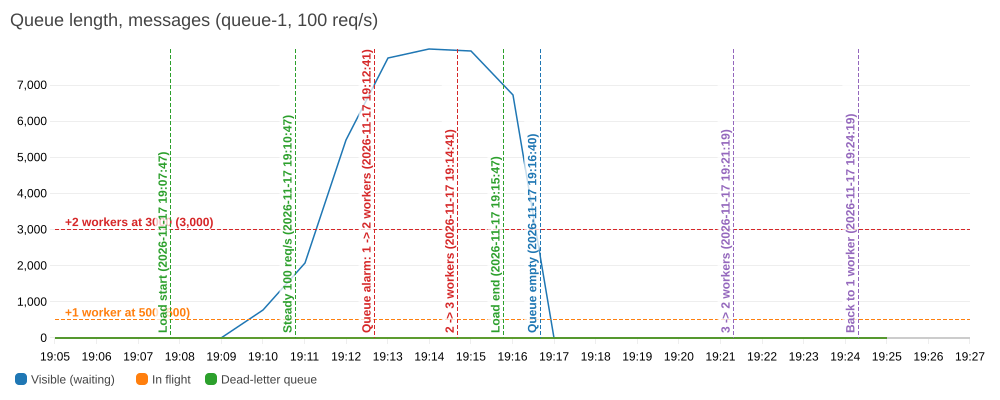
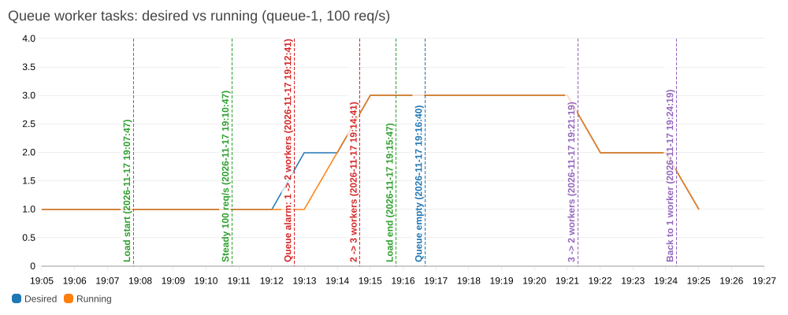
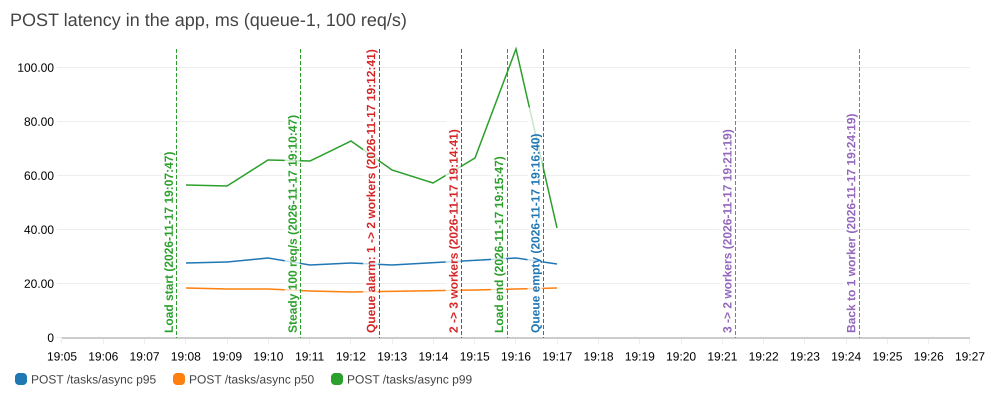
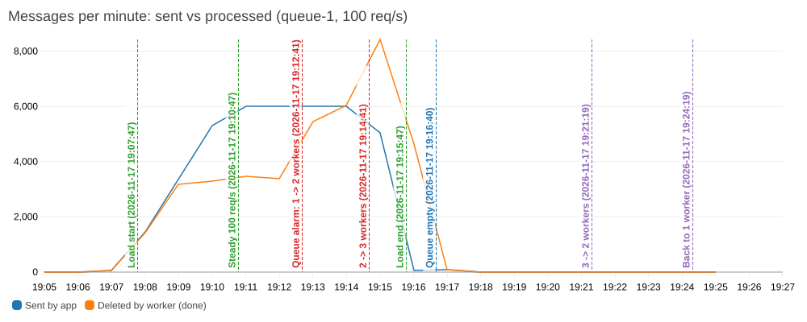
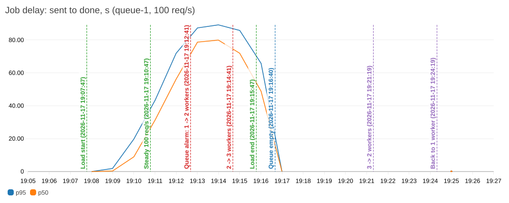
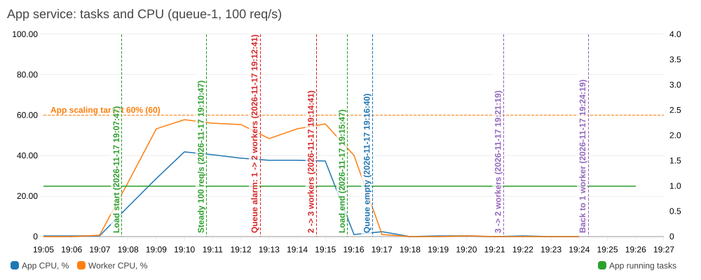

# Асинхронна обробка через чергу

`POST /tasks` не змінювався і, як і раніше, вставляє задачу одразу і відповідає `201`. Поруч додано окрему
операцію `POST /tasks/async`: сервіс лише кладе повідомлення в Amazon SQS і відповідає `202 Accepted`, а задачу
вставляє окремий ECS-сервіс-обробник.

## Що змінилося для клієнта

| | `POST /tasks` | `POST /tasks/async` |
| --- | --- | --- |
| Код відповіді | `201 Created` | `202 Accepted` |
| Тіло | створена задача з `id` | `{"jobId": "...", "status": "queued", "location": "/jobs/<jobId>"}` |
| Заголовки | - | `Location: /jobs/<jobId>` |
| Коли задача є в базі | до відповіді | пізніше, коли її обробить обробник |
| Від чого залежить латентність | INSERT у RDS | лише запис статусу в Redis і відправка в SQS |

`201` означає «зроблено», `202` - лише «прийнято, буде зроблено». Клієнт не отримує `id` задачі у відповіді
і не може одразу її прочитати: до обробки її немає ні в `GET /tasks`, ні в `GET /tasks/:id`.

Як клієнт дізнається результат - опитує адресу з `Location`:

```
POST /tasks/async  {"title":"Купити молоко"}
202  Location: /jobs/b50035d2-a2f0-429b-b5a6-357bc7b5d919

GET /jobs/b50035d2-a2f0-429b-b5a6-357bc7b5d919
200  {"id":"b50035d2-...","status":"queued", ...}

GET /jobs/b50035d2-a2f0-429b-b5a6-357bc7b5d919
200  {"id":"b50035d2-...","status":"done","taskId":159898,"task":"/tasks/159898","attempts":1,"duplicate":false, ...}
```

Статуси (зберігаються в Redis як `job:<id>` на 24 години, потім `404`):

- `queued` - повідомлення в черзі або обробляється;
- `done` - задачу вставлено, `taskId` і `task` вказують на неї; `attempts` - з якої спроби доставки;
  `duplicate: true` - повідомлення доставили повторно, і обробник повернув уже створену задачу;
- `failed` - усі 5 спроб обробки невдалі, повідомлення перейде в dead-letter queue.

Інші варіанти, яких тут немає: webhook на адресу клієнта, push через WebSocket/SSE або довге опитування
(`GET /jobs/:id?wait=20`). Звичайне опитування найпростіше і не потребує, щоб клієнт приймав вхідні з'єднання.

Повтор `POST /tasks/async` після таймауту безпечний з `Idempotency-Key` ([IDEMPOTENCY.md](IDEMPOTENCY.md)):
сервер поверне ту саму відповідь `202` з тим самим `jobId`, і друге повідомлення в чергу не піде. Якщо Redis
або SQS недоступні, клієнт отримує `503` і знає, що операцію не прийнято.

## Як влаштовано

```
клієнт -> ALB -> app (ECS) --SendMessageBatch--> SQS cloude-tech-lab1-jobs --ReceiveMessage--> worker (ECS) -> RDS
                  |                                   |  5 невдалих спроб                         |
                  +-- job:<id> = queued (Redis)       +--> cloude-tech-lab1-jobs-dlq              +-- job:<id> = done (Redis)
```

**app** (`app/src/routes.js`, `queue.js`):

1. перевіряє токен, `title` і `Idempotency-Key`;
2. генерує `jobId` (UUID) і записує в Redis `job:<id> = {"status":"queued"}`;
3. кладе в SQS повідомлення `{"jobId","title","author"}`. Повідомлення збираються в пакети `SendMessageBatch`:
   до 10 штук або 10 мс очікування. Без пакетів кожен запит робив окремий підписаний HTTPS-виклик до SQS, і
   вже на 100 запитах/с одна задача app стояла на 97% CPU, а з пакетами на 150 запитах/с - 59% (калібрування
   нижче). При 100-150 запитах/с за 10 мс у пакет потрапляє в середньому лише 1-2 повідомлення, тож виграш,
   найімовірніше, не лише від меншої кількості викликів, а й від меншої кількості одночасних з'єднань до SQS
   (менше TLS-рукостискань). Розміри пакетів окремо не вимірювались: SQS не публікує кількість викликів API у
   CloudWatch. Ціна - до 10 мс додаткової затримки (p50 у k6 42 мс проти 35 мс без пакетів);
4. відповідає `202` з `Location`. Якщо відправка в SQS не вдалася, запис `job:<id>` видаляється і клієнт
   отримує `503`.

**Черга** (`infra/main/sqs.tf`): standard queue, visibility timeout 30 с, long polling 20 с, повідомлення
живуть 1 добу (як і статус у Redis). Redrive policy: після 5 отримань без видалення повідомлення переходить у
`cloude-tech-lab1-jobs-dlq` (зберігає 14 днів; `redrive_allow_policy` дозволяє бути DLQ лише для цієї черги).
Alarm `cloude-tech-lab1-jobs-dlq-not-empty` шле лист через той самий SNS, коли в DLQ щось з'являється.

**Обробник** (`app/src/worker.js`) - окремий ECS-сервіс `cloude-tech-lab1-worker` з тим самим образом і командою
`node src/worker.js`, у приватних підмережах, без балансувальника і з власною security group без вхідних правил
(доступ до RDS і Redis відкрито правилами з цієї SG):

1. long polling: `ReceiveMessage` з `WaitTimeSeconds = 20`, по 1 повідомленню (`WORKER_BATCH_SIZE = 1`,
   `WORKER_CONCURRENCY = 1`, вибір - у розділі про калібрування);
2. `idempotency.run("job", jobId, ...)` - той самий механізм, що й `Idempotency-Key` (бонус 7): перша обробка
   вставляє задачу і запам'ятовує результат, повторна повертає збережений;
3. INSERT у RDS та інвалідація кешу списку `tasks:recent` (спільна з `POST /tasks` функція `createTask`);
4. `job:<id> = {"status":"done","taskId":...}`;
5. `DeleteMessageBatch` лише для успішно оброблених повідомлень;
6. при помилці повідомлення не видаляється, а `ChangeMessageVisibility` відкладає наступну спробу на
   5, 10, 20, 40 с (експоненційно). На 5-й невдалій спробі статус стає `failed`, а наступне отримання SQS
   переносить повідомлення в DLQ;
7. graceful shutdown: на SIGTERM обробник припиняє брати нові повідомлення (перериває long poll через
   `AbortController`), дочікується поточних, закриває з'єднання з RDS і Redis і виходить з кодом 0. ECS дає на
   це `stopTimeout = 30` с, власний таймаут обробника - 25 с.

Обробник пише в журнал метрики у форматі CloudWatch Embedded Metric Format (`app/src/metrics.js`): `JobLatency`
(від `SentTimestamp` повідомлення до `done`), `JobsProcessed`, `JobsFailed`. Застосунок так само пише `Latency`
для `POST /tasks/async` і `POST /tasks`. Окремих прав на `PutMetricData` для цього не треба: CloudWatch Logs
сам видобуває метрики з рядків журналу.

### Права за принципом найменших привілеїв

| Роль | Дозволено | На що |
| --- | --- | --- |
| `cloude-tech-lab1-app-task` (task role застосунку) | `sqs:SendMessage` (ним же авторизується `SendMessageBatch`) | лише черга `jobs` |
| `cloude-tech-lab1-worker-task` (task role обробника) | `sqs:ReceiveMessage`, `sqs:DeleteMessage`, `sqs:ChangeMessageVisibility` | лише черга `jobs` |
| `cloude-tech-lab1-ecs-execution` (спільна execution role) | pull з ECR, журнали, секрети з Secrets Manager | без змін |
| `cloude-tech-lab1-github-actions` (OIDC) | `ecs:UpdateService`, `ecs:DescribeServices` | сервіси `app` і `worker` |
| | `iam:PassRole` | execution role і обидві task role |

Застосунок не може читати чи видаляти повідомлення, обробник не може їх відправляти, і жоден не має доступу до
DLQ. Обробник не отримує `JWT_SECRET` і `AUTH_PASSWORD`, лише пароль RDS.

### Деплой

`deploy.yml` після оновлення сервісу `app` бере поточну task definition обробника, підставляє той самий образ
(тег = SHA коміту) і оновлює сервіс `cloude-tech-lab1-worker`, чекаючи стабільності.

### Автомасштабування обробника

`infra/main/worker.tf`: `aws_appautoscaling_target` (1-3 задачі) і дві політики `StepScaling` за
`ApproximateNumberOfMessagesVisible` черги (Maximum за хвилину):

| Alarm | Умова | Дія | Cooldown |
| --- | --- | --- | --- |
| `cloude-tech-lab1-worker-queue-high` | ≥ 500 повідомлень, 1 хвилина | 500-2999: +1 задача, ≥ 3000: +2 | 60 с |
| `cloude-tech-lab1-worker-queue-low` | < 50 повідомлень, 3 хвилини поспіль | -1 задача | 120 с |

Чому step scaling, а не target tracking: target tracking розрахований на метрику, яка падає пропорційно кількості
задач (як середній CPU). Довжина черги так не поводиться - вона залежить від різниці між швидкістю надходження
і обробки. Для target tracking AWS радить метрику «backlog на задачу» (`Visible / RunningTaskCount` через metric
math) і цільовий час розбору. Тут умова прямо просить масштабувати від `ApproximateNumberOfMessagesVisible`, тому
пороги задано явно.

Чому 500 і 50: під час калібрування з батчами по 10 повідомлень у черзі весь час «видно» 200-300 повідомлень
навіть без відставання (вони чекають наступного `ReceiveMessage`), і поріг 100 один раз помилково додав задачу
(18:46). 500 повідомлень - це ~9 с роботи одного обробника, тобто справжнє відставання. 50 і 3 хвилини для
scale-in - щоб не знімати задачу, поки черга ще розбирається.

## Калібрування

Короткі прогони `queue.js` (`loadtest/results/calib-queue-*.json`), щоб черга під час основного прогону росла,
а не зникала одразу:

| Прогін | Що змінено | Запитів/с | p95 `POST /tasks/async` (k6) | CPU app | Обробник |
| --- | --- | --- | --- | --- | --- |
| `calib-queue-100` | без пакетів, обробник по 10 повідомлень паралельно | 100 | 208 мс | 97% | встигає, CPU 51% |
| `calib-queue-150` | `SendMessageBatch` в app | 150 | 118 мс | 59% | встигає, CPU 65% |
| `calib-queue-c1` | обробник: пакет 10, паралельність 1 | 120 | 61 мс | - | встигає, у черзі до 282 |
| `calib-queue-b1` | обробник: по 1 повідомленню | 60 | 54 мс | - | ~55 повідомлень/с, у черзі до ~640 |

Висновок: сама вставка дешева, і обробник із 10 паралельними повідомленнями розбирав 150 повідомлень/с на 65%
CPU (оцінка межі ~230/с на 0.25 vCPU) - не повільніше, ніж app на одній задачі встигає приймати. Тоді черга не росте і показувати нічого. Тому
обробник обробляє одне повідомлення за раз: кожна задача робить не більше одного запису в RDS одночасно,
~56 повідомлень/с. Це і є головна роль черги - вирівнювання навантаження: скільки б запитів не прийшло, база
отримує рівномірний потік записів, а надлишок чекає в черзі. Штучних затримок (`sleep`) в обробнику немає.

Для основного прогону обрано 100 запитів/с: це ~1.8 обробника, тож з 1 задачею черга росте, з 2 стоїть, з 3
розбирається, а app на одній задачі має ~40% CPU і не виходить за ціль масштабування 60%.

## Прогін

```powershell
.\loadtest\run.ps1 -Script queue.js -Rate 100 -RunName queue-1
```

17.11.2026, 19:07:47-19:17:47 за Києвом. Фази: наростання 0 → 100 запитів/с за 3 хв, 100 запитів/с 5 хв, 2 хв
без навантаження. Два спостерігачі весь час створювали по одній операції і опитували `GET /jobs/:id` раз на
секунду. Результат - `loadtest/results/queue-1.json`.

| Показник | Значення |
| --- | --- |
| `POST /tasks/async` | 39 442, усі `202`, помилок HTTP 0 |
| SQS: надіслано / отримано / видалено | 39 442 / 39 442 / 39 442 |
| Повторних доставок | 0 (отримано рівно стільки, скільки надіслано) |
| Dead-letter queue | 0 |
| Операції спостерігачів | 392 `done`, 0 `failed`, 0 не дочекалися |
| Найдовша черга | 7 998 повідомлень (19:14) |
| Обробник | 1 → 2 → 3 → 2 → 1 задача |
| App | весь час 1 задача, CPU ≤ 42% |

### Латентність запису не росте

k6 (з боку клієнта, разом із мережею до Франкфурта), `POST /tasks/async`:

| Фаза | p50 | p95 | p99 | max |
| --- | --- | --- | --- | --- |
| Наростання | 43.0 мс | 59.4 мс | 112.6 мс | 175.5 мс |
| Стале навантаження (черга до 8 000) | 41.9 мс | 58.5 мс | 109.9 мс | 198.1 мс |
| Без навантаження | 45.2 мс | 64.7 мс | 111.5 мс | 132.4 мс |

Метрика `Latency` із самого застосунку (CloudWatch, по хвилинах): p50 17.2-18.6 мс, p95 27.1-29.7 мс протягом
усього прогону, разом із хвилинами, коли в черзі лежало 8 000 повідомлень. Латентність `POST /tasks/async` не
залежить від довжини черги і швидкості обробника: сервіс лише кладе повідомлення в SQS.

Росте інше - час, поки клієнт дочекається `done`:

| Коли створено операцію | p50 | p95 | max |
| --- | --- | --- | --- |
| Наростання | 1.0 с | 4.1 с | 26.7 с |
| Стале навантаження | 72.8 с | 86.5 с | 87.3 с |
| Без навантаження | 1.0 с | 1.1 с | 35.9 с |

(Спостерігачі опитують раз на секунду, тож 1.0 с означає «готово з першого опитування».) Метрика `JobLatency`
з обробника показує те саме: p95 до 89.3 с о 19:14. Саме це клієнт «платить» за швидку відповідь `202`:
результат з'являється, коли до повідомлення дійде черга.

### Хронологія

| Час | Що сталося |
| --- | --- |
| 19:07:47 | початок навантаження |
| ~19:09:30 | надходить більше, ніж ~56/с, що встигає 1 обробник: черга росте (19:09 - 3 420 надіслано, 3 165 оброблено) |
| ~19:10:10 | у черзі > 500 |
| 19:10:47 | стале навантаження 100 запитів/с (~6 000 за хвилину) |
| 19:12:41 | `worker-queue-high` → ALARM: desired 2 (у черзі вже ~5 500) |
| 19:13:45 | друга задача працює; 2 обробники ≈ 6 000 за хвилину, черга перестає рости на ~8 000 |
| 19:14:41 | повторне спрацювання: desired 3, задача працює з 19:15:17 |
| 19:15 | 3 обробники: 8 428 оброблено за хвилину при 5 054 надісланих, черга зменшується |
| 19:15:47 | кінець навантаження |
| 19:16:40 | черга порожня |
| 19:21:19 | `worker-queue-low` (3 хвилини < 50) → desired 2 |
| 19:24:19 | desired 1; у журналах обох зупинених задач `SIGTERM received, finishing in-flight messages` і `Worker stopped` у ту саму секунду |

Від перетину порогу 500 до першої нової задачі минає ~2.5 хв. За історією alarm він перейшов у ALARM о
19:12:40 за точкою хвилини 19:10 (максимум 783): хвилинна точка SQS з'являється в CloudWatch лише через ~1.7 хв
після закриття хвилини, а потім задача ще ~30-60 с стартує. Через це перший крок дав лише +1 (783 < 3 000), хоча
в черзі на той момент було вже ~5 500. Поки alarm лишається в ALARM, Application Auto Scaling повторно викликає
політику після cooldown, і о 19:14:41 додалася третя задача. Зняття задач: `worker-queue-low` перейшов у ALARM о
19:21:19 за трьома нульовими точками 19:17-19:19, тобто через ~4.5 хв після спорожніння черги; далі по одній
задачі з cooldown.

### Знімки панелі

Графіки з тих самих метрик, що й dashboard `cloude-tech-lab1` (на панель додано довжину черги, задачі обробника,
латентність `POST` у застосунку, повідомлення за хвилину, затримку операцій і CPU обробника), побудовані через
`aws cloudwatch get-metric-widget-image` за 19:05-19:27. Вертикальні лінії: початок навантаження, вихід на
100 запитів/с, 1 → 2 і 2 → 3 обробники, кінець навантаження, черга порожня, 3 → 2 обробники, повернення до 1.













Що видно:

- черга росте, поки обробників менше двох, стоїть на ~8 000 з двома і зникає за хвилину після кінця
  навантаження з трьома;
- p50 і p95 латентності `POST /tasks/async` - рівні лінії весь прогін. Сплеск p99 о 19:16 - це хвилина, коли
  запити слали лише два спостерігачі, і p99 рахувався з кількох десятків значень;
- лінія «оброблено» відстає від «надіслано» на рівні ~3 400 за хвилину (1 обробник), вирівнюється на 6 000
  (2 обробники) і обганяє його до 8 428 (3 обробники);
- app весь час на 1 задачі з CPU ~38-42%, тобто нижче цілі масштабування 60%.

Після прогону всі сервіси повернулися до мінімуму: app 1, обробник 1, Redis 1, черга і DLQ порожні.

## Доставка «щонайменше один раз»

SQS standard queue гарантує, що кожне повідомлення буде доставлене **щонайменше один раз**, але не рівно один
раз:

- `ReceiveMessage` не видаляє повідомлення, а лише ховає його на visibility timeout (30 с). Видаляє його
  обробник явним `DeleteMessage` після успіху. Якщо обробник упав, його зупинили, він не встиг за 30 с або
  `DeleteMessage` не дійшов, повідомлення знову стане видимим і його отримає інший обробник;
- SQS зберігає копії повідомлення на кількох серверах і зрідка може віддати копію повторно навіть без збою.

Протилежна гарантія - «щонайбільше один раз»: видалити повідомлення одразу при отриманні. Тоді дублів немає,
але збій посеред обробки губить повідомлення назавжди. Черги зазвичай обирають «щонайменше один раз», бо
загублений запис виправити неможливо, а дубль можна відкинути на боці обробника. (FIFO-черги SQS дають
дедуплікацію в межах 5 хвилин, але з нижчою пропускною здатністю; повторну обробку після збою обробника вони
все одно не усувають.)

### Що буде при повторній обробці

Без захисту - друга задача з тим самим `title`. Тут обробник ідемпотентний: ключ `idem:job:<jobId>` у Redis
(механізм із [IDEMPOTENCY.md](IDEMPOTENCY.md)).

- Повідомлення вже оброблене: обробник бачить збережений результат, не робить INSERT, ставить статус `done` з
  тим самим `taskId` і `duplicate: true` і видаляє повідомлення.
- Дві копії обробляються одночасно (наприклад, перша обробка перевищила visibility timeout): друга бачить lock
  першої, чекає до 2 с і, якщо результату ще немає, вважає спробу невдалою; повідомлення повертається в чергу
  з затримкою 5 с і наступного разу отримує збережений результат.
- Обробка падає постійно (наприклад, зіпсоване повідомлення): 5 спроб з наростаючою затримкою, статус
  `failed`, повідомлення в DLQ, alarm на email. Локально з ElasticMQ (`maxReceiveCount = 3`) повідомлення
  `not json` пройшло 3 спроби і опинилося в DLQ.

Перевірка в AWS: те саме повідомлення `{"jobId":"484ae0b3-...","title":"duplicate delivery check 484ae0b3",...}`
відправлено в чергу двічі через `aws sqs send-message` (так виглядає повторна доставка):

```
job: {"id":"484ae0b3-3534-427d-be30-beaf446c2587","status":"done","taskId":247858,"attempts":1,"duplicate":true, ...}
rows with title: 1
worker log: Job 484ae0b3-3534-427d-be30-beaf446c2587 already processed, task 247858, attempt 1
```

Два повідомлення - одна задача в базі. Межі цього захисту ті самі, що й для `Idempotency-Key`: результат живе в
Redis 24 години, і якщо Redis втратить дані (перезапуск без збереження на диск), повторна доставка після цього
створить дубль. Надійніше зберігати `jobId` в унікальній колонці таблиці в тій самій транзакції, що й задачу.

## Вартість

- SQS: перший мільйон запитів на місяць безкоштовний. Один обробник у простої робить 3 long poll на хвилину,
  ~130 тис. запитів на місяць. Прогін з 39 442 повідомленнями - менше 120 тис. запитів: `ReceiveMessage` і
  `DeleteMessageBatch` по одному на повідомлення плюс `SendMessageBatch` (не більше одного на повідомлення).
- Обробник: ще одна задача Fargate 0.25 vCPU / 512 МБ постійно, $0.014195 за годину ≈ $10.36 на місяць
  (ціна - у [SCHEDULE.md](SCHEDULE.md)), до 3 задач під навантаженням.
- Журнали з метриками EMF і 5 власних метрик CloudWatch - копійки при такому навантаженні.
